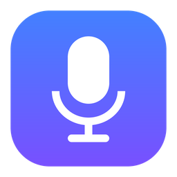
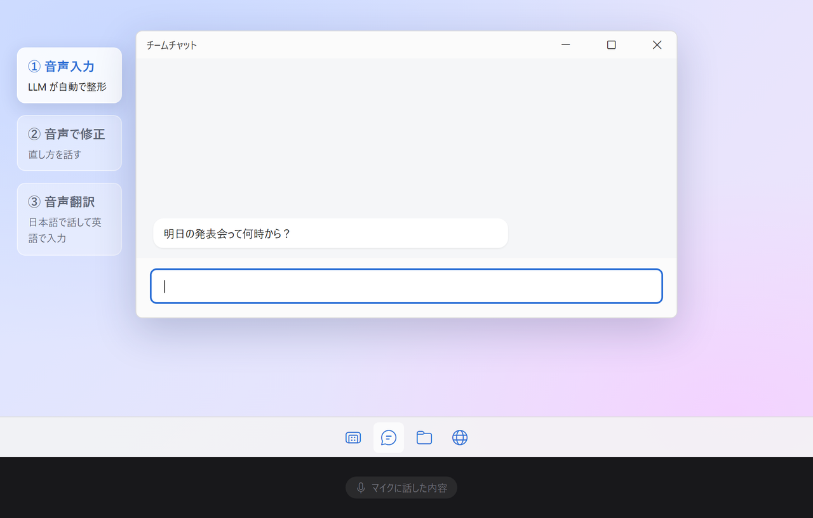
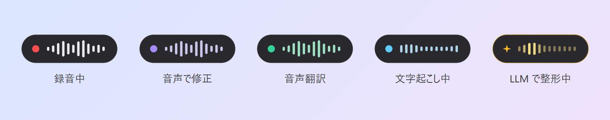
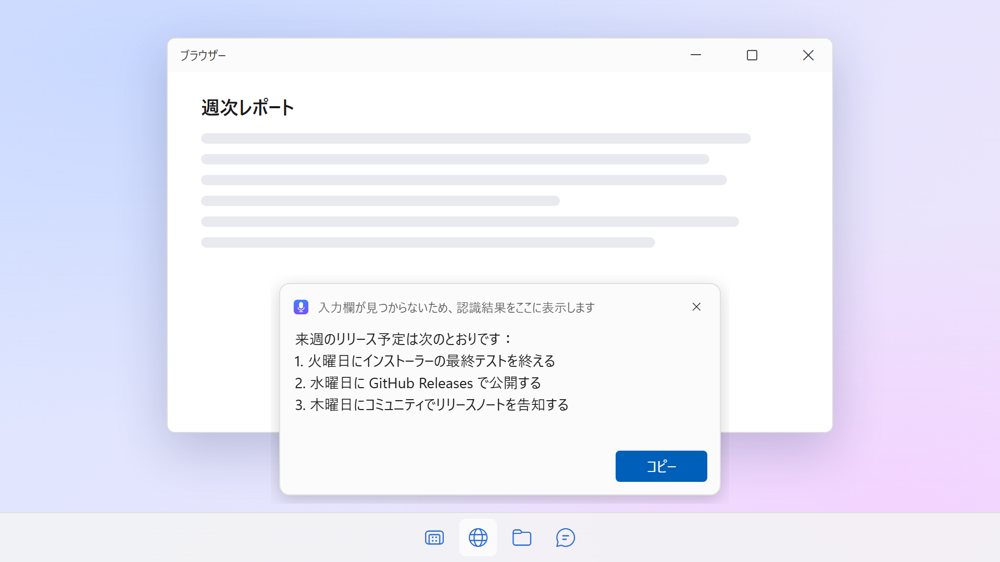
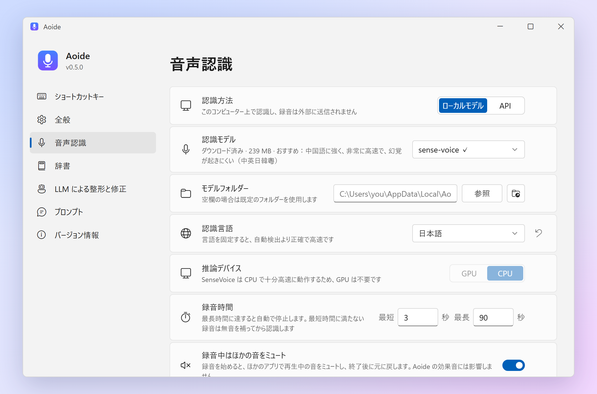

<p align="center">
  
</p>

<h1 align="center">Aoide</h1>

<p align="center">
  <b>Windows・macOS 用のローカル音声入力ツール</b><br>
  ショートカットキーを押して話し、もう一度押すと、フォーカスのある入力欄に文字が入力されます。
</p>

<p align="center">
  <a href="https://parad1se98.github.io/aoide/"><b>parad1se98.github.io/aoide</b></a>
</p>

<p align="center">
  <a href="https://github.com/PaRaD1SE98/aoide/releases/latest"></a>
  <a href="https://github.com/PaRaD1SE98/aoide/releases/latest"></a>
  <a href="LICENSE"></a>
  
</p>

<p align="center">
  <a href="README.md">English</a> · <a href="README.zh-CN.md">简体中文</a> · <b>日本語</b>
</p>

<p align="center">
  
</p>

<p align="center"><sub><i>Aoide</i>（アオイデー）は、ギリシャ神話で声と歌をつかさどるムーサの名前に由来します</sub></p>

Aoide は Windows と macOS 向けの音声入力アプリで、Typeless や Wispr Flow といった商用ツールのオープンソース版です。

音声は [SenseVoice](https://github.com/FunAudioLLM/SenseVoice)（[sherpa-onnx](https://github.com/k2-fsa/sherpa-onnx) 経由）または [whisper.cpp](https://github.com/ggml-org/whisper.cpp)（Windows では Vulkan、macOS では Metal で GPU アクセラレーション）を使って手元のパソコン上で文字に起こされます。必要に応じて OpenAI 互換の任意の API で LLM が整形し、そのままフォーカスのある入力欄に入力します。

アカウントもクラウドサービスも不要です。ローカルモデルの代わりに音声認識 API を使うよう設定しない限り、音声がパソコンの外に出ることはありません。

## 機能

| 機能 | 操作 | 結果 |
|---|---|---|
| **音声入力** | `右 Alt` を 1 回押す → 話す → もう一度 `右 Alt` を押す | 文字起こし・整形してから、フォーカスのある入力欄に貼り付けます |
| **キャンセル** | 録音中・認識中に `Esc` を押す | その処理を中止し、何も入力しません |
| **音声で修正** | テキストを選択 → `右 Alt` を押したまま `Space` を押す → 修正内容を話す → `右 Alt` を押す | 話した指示どおりに LLM が選択範囲を書き直して置き換えます |
| **音声翻訳** | `右 Alt` を押したまま `T` を押す → 話す → `右 Alt` を押す | 話した内容を LLM が翻訳先の言語に翻訳して入力します。続いて表示される小さなウィンドウに認識された原文が表示され、認識の誤りを直して **再翻訳** を押すと、入力欄の訳文が置き換わります。翻訳先の言語は録音中にフローティングバーの上で選ぶか、設定で変更できます |

> macOS の既定のショートカットキーは `右 Option` で、トレイアイコンはメニューバーに表示されます。これらのキーがないことが多い日本語（JIS）キーボードでは、Windows は `変換` キー、macOS は `右 Command` が既定です。音声で修正は、そのキー + `Space` です。

- **フィードバック**：開始・終了・キャンセルでそれぞれ異なる効果音が鳴ります。画面下部のフローティングバーに処理の状態が表示され（録音が最長時間に近づくと最後の 20 秒をカウントダウン）、トレイアイコンには録音中は赤、完了時は緑のバッジが付きます。エラーなどのメッセージは画面下部の小さな通知に表示され、自動で閉じます（システム通知を使わないため、通知をオフにしていても見逃しません）。

  

- **スマートな出力**：フォーカスのあるコントロールに入力できる場合は結果を貼り付け、その後で元のクリップボードのテキストを戻します。入力できない場合は、画面下部の小さなカードに結果を表示し、**コピー**・**閉じる** ボタンで扱えるので、内容が失われることはありません。

  

- **文脈に合わせた挿入**：カーソルが既存のテキストの途中にあるとき、LLM がカーソル前後のテキストを参照し、カーソル位置に入るべき部分だけを、前後の言語や句読点に合わせて書きます。既存のテキストは一切変更せず、結果はカーソル位置に貼り付けます。短い音声入力は速さを優先して文字起こし結果をそのまま挿入し、長い入力のときだけ LLM を使います（しきい値は変更可能）。LLM API の設定が必要です。パスワード欄は決して読み取りません。
- **言葉を覚える**：人名、製品名、専門用語など、何度も誤認識される言葉は一度直すだけで済みます。入力された後で入力欄の中の言葉を直すと、Aoide は自分が入力した内容と修正後を比べ、読みが近いことを確かめたうえで（言い換えを誤認識と取り違えないため）、その組み合わせを辞書に追加し、**元に戻す** ボタン付きの小さな通知を表示します。次からは、繰り返し直した誤認識はそのまま置き換え、それ以外は関連する辞書の項目と一緒に LLM に渡し、文脈に合わせて直させます。**設定 → 辞書** から手動で単語を追加することもできます。
- **LLM による整形**：「えー」「あの」などのフィラーを取り除き、途切れた文をつなげたうえで、内容を整理します。いくつかの要点を話すと「短い前置き + 番号付きリスト」に、長めの説明は段落に分け、短いメッセージは 1 文のままにします。話していない内容を付け足すことはありません。体裁と言葉づかいのルールは、整形・挿入・音声で修正・翻訳に共通の「出力スタイル」プロンプトにまとめてあり、**設定 → プロンプト** で編集できます。
- **自動アップデート**：1 日 1 回新しいバージョンを確認し、画面下部の通知とトレイメニューの項目でお知らせします。ワンクリックで更新でき、署名付きのインストーラーをダウンロード・検証してインストールし、Aoide が自動で再起動します。音声入力中に更新することはありません。毎日の確認はオフにでき、**設定 → バージョン情報** から手動で確認することもできます。
- **2 つの音声認識エンジン**：SenseVoice（既定）はどの CPU でも高速で、中国語の精度が非常に高く、幻覚もほとんど起きません。Whisper モデルは Vulkan を通じて GPU で動作し（NVIDIA、AMD、Intel に対応、CUDA のインストールは不要）、GPU が使えない場合は自動で CPU に切り替わります。Apple シリコン搭載の Mac では Metal を通じて GPU で動作します。

> 表示言語は日本語・英語・中国語に対応しています（設定 → *表示言語*。既定ではシステムの言語に合わせます）。文字起こしは日本語、英語、中国語、韓国語、広東語などに対応しています。

## インストール

### Windows

1. [Releases](https://github.com/PaRaD1SE98/aoide/releases) から `Aoide_x.y.z_x64-setup.exe` をダウンロードして実行します。現在のユーザーにインストールされ、管理者権限は不要です。
2. 初回起動時に設定画面が開きます。**ダウンロード** をクリックして既定の `sense-voice` モデル（239 MB）を取得します。Whisper モデルも同じ一覧から選べます。
3. どこでも `右 Alt` を押して話し始めます。

**動作環境：** Windows 10/11 x64。SenseVoice は CPU だけで動作します。Whisper モデルは Vulkan 対応の GPU ドライバー（最近の NVIDIA、AMD、Intel のドライバー）があると大幅に速くなります。WebView2 ランタイムは Windows 11 にはプリインストールされており、Windows 10 でない場合はインストーラーが自動でインストールします。

### macOS

1. [Releases](https://github.com/PaRaD1SE98/aoide/releases) から `Aoide_x.y.z_aarch64.dmg`（Apple シリコン）または `Aoide_x.y.z_x64.dmg`（Intel）をダウンロードして開き、Aoide を「アプリケーション」にドラッグします。
2. Aoide は Apple の公証を受けていないため、初回起動は macOS にブロックされます。**システム設定 → プライバシーとセキュリティ** を開き、下にスクロールして **このまま開く** をクリックします。
3. Aoide はまずマイクへのアクセスを求めます。その後、まだ足りないアクセス許可が設定画面に表示されるので、*アクセシビリティ*（ショートカットキーの検知とテキストの貼り付けに必要）の横の **システム設定を開く** をクリックし、そこで Aoide をオンにします。一覧は自動で更新され、再起動しなくてもすぐにショートカットキーが使えるようになります。
4. 設定画面でモデルをダウンロードし、どこでも `右 Option`（日本語キーボードでは `右 Command`）を押して話し始めます。

**動作環境：** macOS 11 以降、Apple シリコンまたは Intel。Whisper モデルが GPU（Metal）を使えるのは Apple シリコンだけです。Intel Mac では CPU で動作するため、SenseVoice のほうが向いています。

Aoide は Apple Developer ID ではなくアドホック署名なので、macOS はアップデートのたびに Aoide を新しいアプリとして扱い、アクセシビリティの許可を改めて求めます。アクセシビリティの一覧に残る古い項目は Aoide が自動で削除します。設定画面の **システム設定を開く** をクリックし、Aoide をもう一度オンにしてください。macOS にはアプリごとに音量を調整する仕組みがないため、*録音中はほかの音をミュート* は出力デバイス全体をミュートします。

モデルは Hugging Face からダウンロードします。ミラーを使う場合は環境変数 `HF_ENDPOINT` を設定してください。

## 使い方

スタートメニューから Aoide を起動するとウィンドウが開きます。ウィンドウを閉じてもシステムトレイで動作し続けるので、ショートカットキーはそのまま使えます。トレイアイコンをクリックするか、もう一度起動するとウィンドウが再び開き、トレイアイコンを右クリック → *終了* で終了します。Windows と同時に起動した場合は、ウィンドウを開かずにトレイで動作します。

macOS では Aoide はメニューバーで動作します。アイコンをクリックするとウィンドウが開き、右クリックでメニューが表示されます。Dock のアイコンはウィンドウを開いている間だけ表示されます。



### API で音声認識する（任意）

既定ではローカルモデルで認識します。クラウドや自前のサービスを使う場合は、**設定 → 音声認識 → 認識方法** で **API** を選び、API ベース URL、API Key、モデル名を入力します。

Aoide は OpenAI の音声認識形式（`POST {API ベース URL}/audio/transcriptions`）を使います。事実上の標準形式で、多くのサービスが対応しています：

| サービス | API ベース URL | モデル名（例） |
|---|---|---|
| OpenAI | `https://api.openai.com/v1` | `gpt-4o-mini-transcribe`、`whisper-1` |
| Groq | `https://api.groq.com/openai/v1` | `whisper-large-v3-turbo` |
| SiliconFlow | `https://api.siliconflow.cn/v1` | `FunAudioLLM/SenseVoiceSmall` |
| Mistral | `https://api.mistral.ai/v1` | `voxtral-mini-latest` |
| 自前のサーバー（vLLM、LocalAI など） | 例：`http://localhost:8000/v1` | 提供しているモデル |

ほかの形式のサービス（Deepgram、Azure、Gemini、ElevenLabs など）は、[LiteLLM](https://docs.litellm.ai/docs/audio_transcription) でこの形式に変換すれば使えます。認識言語と単語帳（プロンプトとして）も一緒に送信します。ローカルモデルをダウンロード済みの場合は、先にローカルで無音部分を取り除くため、話していない録音はアップロードされません。

### LLM の設定（整形・音声で修正）

ローカル・リモートを問わず、OpenAI 互換の API なら何でも使えます。設定画面で次の項目を入力します。

- *API ベース URL* — 例：`https://api.openai.com/v1`
- *API Key* — サーバー側で不要な場合は空欄のままにします
- *モデル名*

**思考を無効化**（既定でオン）は、`reasoning_effort` などの標準的な API パラメーターで推論モデルに思考の段階を省かせるもので、待ち時間を大幅に短くできます。これらのパラメーターに対応していないサーバーでは、自動で通常のリクエストに切り替わります。

## 設定項目

設定は `%APPDATA%\Aoide\config.json`（macOS：`~/Library/Application Support/Aoide/config.json`）に保存され、通常は設定画面から変更します。

| キー | 既定値 | 説明 |
|---|---|---|
| `ui_language` | `auto` | 表示言語：`auto`（システムに合わせる）/ `zh` / `en` / `ja` |
| `hotkey` | `right alt` | 録音の開始・停止（1 回押しで動作）。macOS の既定は `right option`、日本語（JIS）キーボードでは Windows が `convert`（変換）、macOS が `right command` |
| `revise_hotkey` | `right alt+space` | 音声で修正を開始。`<メインのキー>+<キー>` は、メインのキーを押したままそのキーを押すことを表します |
| `translate_hotkey` | `right alt+t` | 音声翻訳を開始（メインのキーを押したままこのキーを押す）。メインのキーを押して終了 |
| `translate_language` | `English` | 音声翻訳の翻訳先の言語。任意の言語名を指定できます |
| `revise_stop_hotkey` | `right alt` | 音声で修正を終了（`hotkey` と同じ場合は 1 回押しの動作にまとめます） |
| `cancel_hotkey` | `esc` | 録音中・認識中の処理をキャンセル。処理中だけこのキーを横取りします |
| `speech_source` | `local` | 音声認識の方法：`local`（ローカルモデル）/ `api`（OpenAI 互換の音声認識 API） |
| `speech_api` / `speech_api_key` / `speech_api_model` | *（空）* | `speech_source` が `api` のときに使う API ベース URL、Key、モデル名 |
| `model` | `sense-voice` | SenseVoice：`sense-voice`（中・英・日・韓・粵）/ `sense-voice-yue`（広東語強化版）。Whisper：`tiny` / `base` / `small` / `medium` / `large-v3-turbo-q5_0` / `large-v3-turbo` / `large-v2` / `large-v3` |
| `model_dir` | *（空）* | モデルの保存先。空欄 = `%LOCALAPPDATA%\Aoide\models`（macOS：`~/Library/Application Support/Aoide/models`） |
| `language` | `auto` | 文字起こしの言語。`auto` で自動検出。SenseVoice は `zh` / `en` / `ja` / `ko` / `yue` / `auto` に対応 |
| `max_duration` | `90` | 1 回の録音の最大秒数。超えると自動で停止します |
| `min_duration` | `3` | これより短い録音は、無音を足してこの長さにしてから認識します。`0` で無効 |
| `mute_while_recording` | `true` | 録音中は音を再生しているほかのアプリをミュートし、終了後に元に戻します。Aoide の効果音には影響しません。macOS では出力デバイスをミュートします |
| `device` | `gpu` | `gpu`（Vulkan。Apple シリコンの Mac では Metal、Intel Mac では CPU）/ `cpu`。Whisper のみ有効で、SenseVoice は常に CPU で動作します |
| `polish` | `true` | LLM による整形を有効にする（`polish_api` が空の場合はスキップ） |
| `polish_api` | *（空）* | OpenAI 互換 API のベース URL。例：`https://api.openai.com/v1` |
| `polish_api_key` | *（空）* | API キー。不要な場合は空欄 |
| `polish_model` | *（空）* | モデル名 |
| `polish_no_think` | `true` | API パラメーター（`reasoning_effort` など）で推論モデルに思考を省かせる。対応していない場合は無視されます |
| `polish_min_seconds` | `10` | これより短い録音（秒）は整形せず、文字起こし結果をそのまま出力します |
| `polish_min_chars` | `12` | これより短い文字起こし結果（空白を除く）は整形せずそのまま出力します。音声で修正には影響しません |
| `polish_repeat_seconds` | `30` | 短い音声の結果が出てからこの秒数以内にもう一度短く話すと、前回までの認識結果も添えて LLM で整形し、誤認識を直しやすくします。`0` でオフ |
| `insert_smart` | `true` | カーソルの前後にテキストがあるとき、文脈に合わせて挿入する |
| `insert_min_seconds` / `insert_min_chars` | `10` / `12` | これより短い録音・文字起こし結果は LLM を使わずそのまま挿入します |
| `vocab_enabled` | `true` | 辞書で文字起こし結果を補正する。繰り返し出る誤認識はそのまま置き換え、それ以外は関連する項目と一緒に LLM に渡します |
| `learn_from_edits` | `true` | 入力後に手動で直した言葉を辞書に追加する（元に戻せる通知付き） |
| `vocab_max_kb` | `10240` | 単語帳ファイルのサイズ上限（KB）。超えると、自動で覚えた語のうち最も長く使われていないものから削除します（手動で追加した語は削除しません） |
| `auto_check_updates` | `true` | 1 日 1 回新しいバージョンを確認して知らせる。更新するかどうかは常にユーザーが決めます |
| `style_prompt` | *（空）* | 出力スタイルのカスタムプロンプト：整形・挿入・音声で修正・翻訳に共通する体裁（箇条書き、段落）と言葉づかいのルール。空欄 = 内蔵。以下の各プロンプトにはそれぞれの作業だけを書きます |
| `polish_prompt` / `revise_prompt` / `insert_prompt` / `translate_prompt` | *（空）* | 整形（`{text}`）、音声で修正（`{original}`、`{instruction}`）、文脈に合わせた挿入（`{before}`、`{after}`、`{text}`）、音声翻訳（`{language}`、`{text}`）用のカスタム LLM プロンプト。空欄 = 内蔵のプロンプト。設定画面で編集できます |

辞書は `%APPDATA%\Aoide\vocabulary.json` に保存されます。ログファイルは `%APPDATA%\Aoide\logs\app.log`（1 MB を超えるとローテーション）です。macOS ではそれぞれ `~/Library/Application Support/Aoide/vocabulary.json` と `~/Library/Application Support/Aoide/logs/app.log` です。ログには文字起こしの内容が含まれ、手元のパソコンにだけ保存されます。

## ソースからのビルド

Aoide は [Tauri 2](https://tauri.app/) のアプリです。バックエンドは Rust（`src-tauri/`）、設定画面は素の HTML/CSS/JS（`ui/`）です。sherpa-onnx は音声合成（TTS）モジュールを除いてソースからビルドするため、GPL のコード（espeak-ng）はアプリに含まれません。

### Windows

必要なツール（すべて `winget` でインストールできます）。Visual Studio 2022 は **17.10 以降** が必要です（ビルド済みの ONNX Runtime ライブラリが新しい MSVC STL を必要とするため）。

```powershell
winget install Rustlang.Rustup OpenJS.NodeJS.LTS pnpm.pnpm Kitware.CMake LLVM.LLVM KhronosGroup.VulkanSDK
winget install Microsoft.VisualStudio.2022.BuildTools --override "--add Microsoft.VisualStudio.Workload.VCTools --includeRecommended --passive"
cargo install cargo-about --locked --features cli   # サードパーティのライセンスページの生成に使用
```

続いて PowerShell で：

```powershell
. .\scripts\build-env.ps1            # MSVC の環境、Vulkan SDK と LLVM のパスを読み込む
.\scripts\build-sherpa-onnx.ps1      # 初回のみ：TTS なしの sherpa-onnx をビルド → src-tauri\vendor\sherpa-onnx
.\scripts\third-party-licenses.ps1   # 同梱するライセンスページ → src-tauri\vendor\THIRD_PARTY_LICENSES.html
pnpm install
pnpm tauri dev                       # 開発モードで実行
pnpm tauri build                     # インストーラーをビルド → src-tauri\target\release\bundle\nsis\
```

sherpa-onnx のビルドと、アプリの初回ビルド（whisper.cpp とその Vulkan シェーダー）にはどちらも時間がかかります。依存関係を変更したら `third-party-licenses.ps1` を実行し直してください。

### macOS

必要なツール：Xcode コマンドラインツール、[Rust](https://rustup.rs/)、それに [Homebrew](https://brew.sh/) でインストールする次のもの：

```bash
xcode-select --install
brew install node pnpm cmake
brew install --cask powershell                     # ライセンスページ生成スクリプトの実行に使用
cargo install cargo-about --locked --features cli
```

続いて：

```bash
./scripts/build-sherpa-onnx.sh           # 初回のみ：TTS なしの sherpa-onnx をビルド → src-tauri/vendor/sherpa-onnx
pwsh ./scripts/third-party-licenses.ps1  # 同梱するライセンスページ
pnpm install
pnpm tauri dev                           # 開発モードで実行
pnpm tauri build                         # アプリをビルド → src-tauri/target/release/bundle/dmg/
```

開発モードでは、macOS は Aoide を起動したターミナルに対してアクセシビリティの許可を求めます。

### プラットフォーム固有のコード

OS とやりとりするコード（キーボードフック、キー入力のシミュレーション、フォーカスの検出、ミュート、フローティングバーのウィンドウ、効果音）は `src-tauri/src/win/` と `src-tauri/src/macos/` にあり、両者は同じインターフェースを提供します。それ以外のコードは共通です。

README のスクリーンショットは `.\scripts\readme-images.ps1`（アプリ自身の描画コードと、ヘッドレスブラウザーで表示した実際の UI ページ）で画面に出さずに生成し、デモアニメーションは `.\scripts\readme-demo.ps1`（[FFmpeg](https://ffmpeg.org/) も必要）で生成するので、UI を変更した後に作り直せます。

## クレジット

- 効果音：**Kenney**（[www.kenney.nl](https://www.kenney.nl)）の [Interface Sounds](https://kenney.nl/assets/interface-sounds)、CC0
- 音声認識：[SenseVoice](https://github.com/FunAudioLLM/SenseVoice)（[sherpa-onnx](https://github.com/k2-fsa/sherpa-onnx) 経由）、[whisper.cpp](https://github.com/ggml-org/whisper.cpp)（[whisper-rs](https://codeberg.org/tazz4843/whisper-rs) 経由）
- Windows のインストーラーには [Khronos Vulkan Loader](https://github.com/KhronosGroup/Vulkan-Loader)（Apache-2.0）を同梱しており、Vulkan ドライバーのないマシンでもアプリが起動できます

## ライセンス

[MIT](LICENSE)。Aoide には、それぞれのライセンス（MIT、Apache-2.0、BSD など）に従うサードパーティのオープンソース コンポーネントも含まれています。一覧とライセンス本文はアプリに同梱されており、**設定 → バージョン情報 → サードパーティのライセンス** で確認できます。
