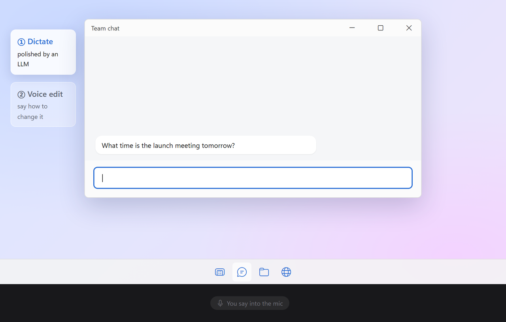
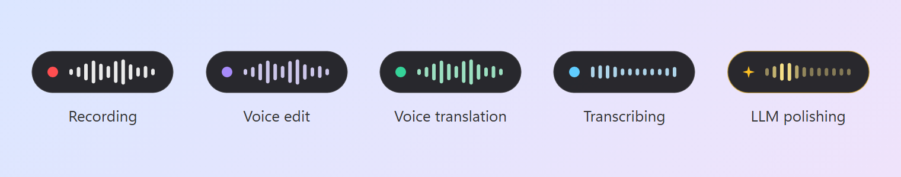
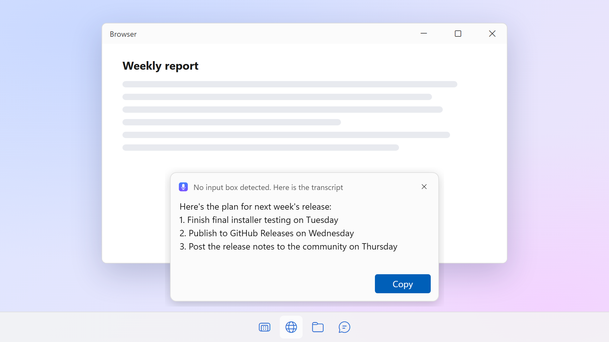
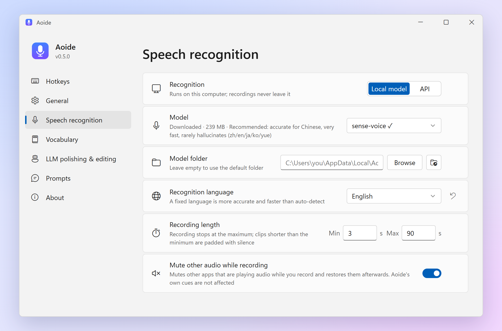

<p align="center">
  
</p>

<h1 align="center">Aoide</h1>

<p align="center">
  <b>Local push-to-talk voice typing for Windows and macOS</b><br>
  Press a hotkey, speak, and your words are typed into whatever input box has focus.
</p>

<p align="center">
  <a href="https://github.com/PaRaD1SE98/aoide/releases/latest"></a>
  <a href="https://github.com/PaRaD1SE98/aoide/releases/latest"></a>
  <a href="LICENSE"></a>
  
</p>

<p align="center">
  <b>English</b> · <a href="README.zh-CN.md">简体中文</a>
</p>

<p align="center">
  
</p>

<p align="center"><sub><i>Aoide</i> (pronounced "ay-OY-dee") is named after the Greek Muse of voice and song</sub></p>

Aoide is a voice typing app for Windows and macOS (preview), an open-source alternative to commercial tools such as Typeless and Wispr Flow.

Your speech is transcribed on your own machine with [SenseVoice](https://github.com/FunAudioLLM/SenseVoice) (via [sherpa-onnx](https://github.com/k2-fsa/sherpa-onnx)) or [whisper.cpp](https://github.com/ggml-org/whisper.cpp) (GPU-accelerated through Vulkan on Windows and Metal on macOS), optionally cleaned up by an LLM through any OpenAI-compatible API, and typed straight into whatever input box has focus.

No account, no cloud service, no audio leaves your computer unless you point the LLM step at a remote API.

## Features

| Feature | How | What happens |
|---|---|---|
| **Dictate** | Tap `Right Alt` → speak → tap `Right Alt` again | Transcribed, polished, and pasted into the focused input box |
| **Cancel** | Press `Esc` while recording or transcribing | The task is discarded, nothing is typed |
| **Voice edit** | Select some text → hold `Right Alt` and press `Space` → say how to change it → tap `Right Alt` | The LLM rewrites the selection according to your instruction and replaces it |

> On macOS the default hotkey is `Right Option`, and the tray icon lives in the menu bar.

- **Feedback**: distinct sounds for start, stop and cancel; a floating bar at the bottom of the screen shows what Aoide is doing; the tray icon gets a red badge while recording and a green one when done. Errors and other messages appear in a small notice at the bottom of the screen that closes on its own (Aoide doesn't use system notifications, so they can't be missed when notifications are off).

  

- **Smart output**: if the focused control accepts text, the result is pasted and your previous clipboard text is restored afterwards. Otherwise the result appears in a small card at the bottom of the screen with **Copy** and **Close** buttons, so nothing is lost.

  

- **Context-aware insertion**: when the cursor sits inside existing text, the LLM sees the text before and after the cursor and writes only the piece that belongs at the cursor, matching the surrounding language and punctuation. The existing text is never changed — the result is pasted at the cursor. Short dictation is inserted as transcribed for speed; the LLM step kicks in for longer input (configurable). Requires an LLM API; password fields are never read.
- **Learns your words**: names, product names and jargon that keep coming out wrong only need to be fixed once. Correct the word in the text box after it is typed, and Aoide compares your edit with what it typed, checks that the two sound alike (so rewording is not mistaken for a recognition error), adds the pair to your vocabulary and shows a small notice with **Undo**. Next time, a misrecognition you have corrected repeatedly is replaced directly; others are passed to the LLM together with the related vocabulary entries, so it can fix them in context. You can also add words by hand under **Settings → Vocabulary**.
- **LLM polishing**: removes filler words ("um", "uh", 嗯, 那个…), joins broken sentences, and turns lists of points into a numbered list — without adding content you didn't say.
- **Automatic updates**: Aoide checks for a new version once a day, lets you know with a notice at the bottom of the screen and a tray menu item, and updates in one click: the signed installer is downloaded, verified and installed, and Aoide restarts on its own. It never updates while you are dictating. You can turn the daily check off and check manually under **Settings → About**.
- **Two speech engines**: SenseVoice (default) is fast on any CPU, very accurate for Chinese and rarely hallucinates; Whisper models run on the GPU through Vulkan (NVIDIA, AMD or Intel, no CUDA install required) and fall back to CPU automatically. On Apple silicon Macs they run on the GPU through Metal.

> The interface is available in English and Chinese (Settings → *Display language*; follows the system language by default). Transcription supports Chinese, English, Japanese, Korean, Cantonese and more.

## Installation

### Windows

1. Download `Aoide_x.y.z_x64-setup.exe` from [Releases](https://github.com/PaRaD1SE98/aoide/releases) and run it. It installs for the current user, no administrator rights needed.
2. On first launch the Settings window opens — click **Download** to fetch the default `sense-voice` model (239 MB). Whisper models can be picked from the same list.
3. Tap `Right Alt` anywhere and start talking.

**Requirements:** Windows 10/11 x64. SenseVoice only needs the CPU; Whisper models are much faster with a Vulkan-capable GPU driver (any recent NVIDIA, AMD or Intel driver). The WebView2 runtime is preinstalled on Windows 11 and is installed automatically on Windows 10 if missing.

### macOS (preview)

1. Download `Aoide_x.y.z_aarch64.dmg` (Apple silicon) or `Aoide_x.y.z_x64.dmg` (Intel) from [Releases](https://github.com/PaRaD1SE98/aoide/releases), open it and drag Aoide into *Applications*.
2. Aoide is not notarized by Apple, so macOS blocks the first launch. Open **System Settings → Privacy & Security**, scroll down and click **Open Anyway**.
3. Allow Aoide under **System Settings → Privacy & Security → Accessibility** (needed to listen for the hotkey and to paste text) and allow microphone access when asked. The hotkey starts working as soon as Accessibility is allowed, no restart needed.
4. Download a model in the Settings window, then tap `Right Option` anywhere and start talking.

**Requirements:** macOS 11 or later, on Apple silicon or Intel. Whisper models use the GPU (Metal) only on Apple silicon; on Intel Macs they run on the CPU, so SenseVoice is the better choice there.

Aoide is signed ad hoc rather than with an Apple Developer ID, so macOS may stop honoring the Accessibility permission after an update. If the hotkey stops working after updating, remove Aoide from the Accessibility list with "−" and add it again. *Mute other apps while recording* mutes the output device on macOS, which has no per-app volume control.

Models are downloaded from Hugging Face. Set the `HF_ENDPOINT` environment variable to use a mirror.

## Usage

Launch Aoide from the Start menu to open its window. Closing the window keeps it running in the system tray, so the hotkeys keep working; click the tray icon or launch it again to bring the window back, and right-click the tray icon → *Quit* to exit. When started with Windows it stays in the tray without opening the window.

On macOS Aoide lives in the menu bar: click its icon to open the window, right-click it for the menu. The Dock icon only shows while the window is open.



### LLM setup (polishing / voice edit)

Any OpenAI-compatible API works, local or remote. In Settings, fill in:

- *API base* — e.g. `https://api.openai.com/v1`
- *API Key* — leave empty if your server doesn't require one
- *Model name*

**Disable thinking** (on by default) asks reasoning models to skip their thinking phase through standard API parameters such as `reasoning_effort`, which cuts latency a lot. Servers that don't support these parameters fall back to a normal request automatically.

## Configuration

Settings are stored in `%APPDATA%\Aoide\config.json` (macOS: `~/Library/Application Support/Aoide/config.json`) and are normally edited through the Settings window.

| Key | Default | Description |
|---|---|---|
| `ui_language` | `auto` | Display language: `auto` (follow the system) / `zh` / `en` |
| `hotkey` | `right alt` | Start/stop recording (triggered on tap). The macOS default is `right option` |
| `revise_hotkey` | `right alt+space` | Start a voice edit. `<main hotkey>+<key>` means: hold the main hotkey, then press the key |
| `revise_stop_hotkey` | `right alt` | Stop a voice edit (merged into the tap logic when equal to `hotkey`) |
| `cancel_hotkey` | `esc` | Cancel the current recording or transcription. Only intercepted while a task is in progress |
| `model` | `sense-voice` | SenseVoice: `sense-voice` (zh/en/ja/ko/yue) / `sense-voice-yue` (Cantonese-tuned). Whisper: `tiny` / `base` / `small` / `medium` / `large-v3-turbo-q5_0` / `large-v3-turbo` / `large-v2` / `large-v3` |
| `model_dir` | *(empty)* | Where models are stored. Empty = `%LOCALAPPDATA%\Aoide\models` (macOS: `~/Library/Application Support/Aoide/models`) |
| `language` | `zh` | Transcription language; `auto` to auto-detect. SenseVoice supports `zh` / `en` / `ja` / `ko` / `yue` / `auto` |
| `max_duration` | `60` | Maximum recording length in seconds; recording stops automatically |
| `min_duration` | `3` | Recordings shorter than this are padded with silence to this length; `0` disables |
| `mute_while_recording` | `true` | Mute other apps that are playing audio while recording, and restore them afterwards. Aoide's own cues are not affected. On macOS the output device is muted |
| `device` | `gpu` | `gpu` (Vulkan; Metal on Apple silicon Macs, CPU on Intel Macs) / `cpu`. Whisper only; SenseVoice always runs on the CPU |
| `polish` | `true` | Enable LLM polishing (skipped while `polish_api` is empty) |
| `polish_api` | *(empty)* | OpenAI-compatible API base URL, e.g. `https://api.openai.com/v1` |
| `polish_api_key` | *(empty)* | API key; leave empty if not required |
| `polish_model` | *(empty)* | Model name |
| `polish_no_think` | `true` | Ask reasoning models to skip thinking via API parameters (`reasoning_effort`, etc.); ignored where unsupported |
| `polish_min_seconds` | `10` | Recordings shorter than this (in seconds) are output as transcribed, without polishing |
| `polish_min_chars` | `12` | Transcripts shorter than this (ignoring spaces) are output as-is without polishing. Doesn't apply to voice edits |
| `insert_smart` | `true` | Context-aware insertion when there is text around the cursor |
| `insert_min_seconds` / `insert_min_chars` | `10` / `12` | Shorter recordings / transcripts are inserted as-is without calling the LLM |
| `vocab_enabled` | `true` | Correct transcripts with your vocabulary: repeated misrecognitions are replaced directly, others go to the LLM with the related entries |
| `learn_from_edits` | `true` | When you correct a word after it is typed, add the correction to the vocabulary (with an Undo notice) |
| `auto_check_updates` | `true` | Check for a new version once a day and notify you; updating is always your choice |
| `polish_prompt` / `revise_prompt` / `insert_prompt` | *(empty)* | Custom LLM prompts for polishing (`{text}`), voice edit (`{original}`, `{instruction}`) and context-aware insertion (`{before}`, `{after}`, `{text}`). Empty = built-in prompt. Edit them in Settings |

The vocabulary is stored in `%APPDATA%\Aoide\vocabulary.json`. The log file is `%APPDATA%\Aoide\logs\app.log` (rotated at 1 MB). On macOS they are `~/Library/Application Support/Aoide/vocabulary.json` and `~/Library/Logs/Aoide/app.log`. It contains your transcripts and stays on your machine.

## Building from source

Aoide is a [Tauri 2](https://tauri.app/) app: the backend is Rust (`src-tauri/`), the settings window is plain HTML/CSS/JS (`ui/`). sherpa-onnx is built from source without its text-to-speech module, so no GPL code (espeak-ng) ends up in the app.

### Windows

Prerequisites (all available through `winget`). Visual Studio 2022 **17.10 or newer** is required — the prebuilt ONNX Runtime library needs a recent MSVC STL:

```powershell
winget install Rustlang.Rustup OpenJS.NodeJS.LTS pnpm.pnpm Kitware.CMake LLVM.LLVM KhronosGroup.VulkanSDK
winget install Microsoft.VisualStudio.2022.BuildTools --override "--add Microsoft.VisualStudio.Workload.VCTools --includeRecommended --passive"
cargo install cargo-about --locked --features cli   # generates the third-party license page
```

Then, in PowerShell:

```powershell
. .\scripts\build-env.ps1            # loads the MSVC environment, Vulkan SDK and LLVM paths
.\scripts\build-sherpa-onnx.ps1      # once: builds sherpa-onnx without TTS → src-tauri\vendor\sherpa-onnx
.\scripts\third-party-licenses.ps1   # bundled license page → src-tauri\vendor\THIRD_PARTY_LICENSES.html
pnpm install
pnpm tauri dev                       # run in development mode
pnpm tauri build                     # build the installer → src-tauri\target\release\bundle\nsis\
```

Building sherpa-onnx and the first app build (whisper.cpp and its Vulkan shaders) both take a while. Re-run `third-party-licenses.ps1` whenever dependencies change.

### macOS

Prerequisites: the Xcode command line tools, [Rust](https://rustup.rs/), and from [Homebrew](https://brew.sh/):

```bash
xcode-select --install
brew install node pnpm cmake
brew install --cask powershell                     # runs the license script
cargo install cargo-about --locked --features cli
```

Then:

```bash
./scripts/build-sherpa-onnx.sh           # once: builds sherpa-onnx without TTS → src-tauri/vendor/sherpa-onnx
pwsh ./scripts/third-party-licenses.ps1  # bundled license page
pnpm install
pnpm tauri dev                           # run in development mode
pnpm tauri build                         # build the app → src-tauri/target/release/bundle/dmg/
```

In development mode macOS asks for the Accessibility permission on behalf of the terminal that started Aoide.

### Platform code

Code that talks to the operating system (keyboard hook, simulated keys, focus detection, muting, the floating bar window, sounds) lives in `src-tauri/src/win/` and `src-tauri/src/macos/`, which provide the same interface; everything else is shared.

The README screenshots are rendered off-screen by `.\scripts\readme-images.ps1` (the app's own drawing code plus the real UI pages in a headless browser), and the demo animation by `.\scripts\readme-demo.ps1` (also needs [FFmpeg](https://ffmpeg.org/)), so they can be regenerated after UI changes.

## Credits

- Sound effects: [Interface Sounds](https://kenney.nl/assets/interface-sounds) by **Kenney** ([www.kenney.nl](https://www.kenney.nl)), CC0
- Speech recognition: [SenseVoice](https://github.com/FunAudioLLM/SenseVoice) via [sherpa-onnx](https://github.com/k2-fsa/sherpa-onnx), and [whisper.cpp](https://github.com/ggml-org/whisper.cpp) via [whisper-rs](https://codeberg.org/tazz4843/whisper-rs)
- The Windows installer bundles the [Khronos Vulkan Loader](https://github.com/KhronosGroup/Vulkan-Loader) (Apache-2.0) so the app also starts on machines without a Vulkan driver

## License

[MIT](LICENSE). Aoide also includes third-party open-source components under their own licenses (MIT, Apache-2.0, BSD and others); the full list and license texts ship with the app under **Settings → About → Third-party licenses**.
