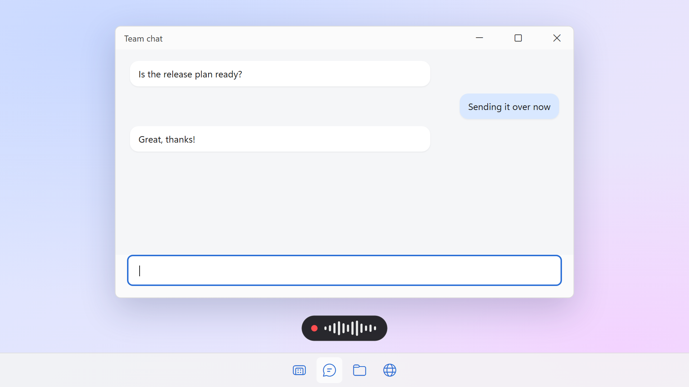

<p align="center">
  
</p>

<h1 align="center">Aoide</h1>

<p align="center">
  <b>Local push-to-talk voice typing for Windows</b><br>
  Press a hotkey, speak, and your words are typed into whatever input box has focus.
</p>

<p align="center">
  <a href="https://github.com/PaRaD1SE98/aoide/releases/latest"></a>
  <a href="LICENSE"></a>
  
</p>

<p align="center">
  <b>English</b> · <a href="README.zh-CN.md">简体中文</a>
</p>

<p align="center">
  
</p>

<p align="center"><sub><i>Aoide</i> (pronounced "ay-OY-dee") is named after the Greek Muse of voice and song</sub></p>

Aoide is a voice typing app for Windows, an open-source alternative to commercial tools such as Typeless and Wispr Flow.

Your speech is transcribed on your own machine with [SenseVoice](https://github.com/FunAudioLLM/SenseVoice) (via [sherpa-onnx](https://github.com/k2-fsa/sherpa-onnx)) or [whisper.cpp](https://github.com/ggml-org/whisper.cpp) (GPU-accelerated through Vulkan), optionally cleaned up by an LLM through any OpenAI-compatible API, and typed straight into whatever input box has focus.

No account, no cloud service, no audio leaves your computer unless you point the LLM step at a remote API.

## Features

| Feature | How | What happens |
|---|---|---|
| **Dictate** | Tap `Right Alt` → speak → tap `Right Alt` again | Transcribed, polished, and pasted into the focused input box |
| **Cancel** | Press `Esc` while recording or transcribing | The task is discarded, nothing is typed |
| **Voice edit** | Select some text → hold `Right Alt` and press `Space` → say how to change it → tap `Right Alt` | The LLM rewrites the selection according to your instruction and replaces it |

- **Feedback**: distinct sounds for start, stop and cancel; a floating bar at the bottom of the screen shows what Aoide is doing; the tray icon gets a red badge while recording and a green one when done.

  

- **Smart output**: if the focused control accepts text, the result is pasted and your previous clipboard text is restored afterwards. Otherwise the result appears in a small card at the bottom of the screen with **Copy** and **Close** buttons, so nothing is lost.

  

- **Context-aware insertion**: when the cursor sits inside existing text, the LLM sees the text before and after the cursor and writes only the piece that belongs at the cursor, matching the surrounding language and punctuation. The existing text is never changed — the result is pasted at the cursor. Short dictation is inserted as transcribed for speed; the LLM step kicks in for longer input (configurable). Requires an LLM API; password fields are never read.
- **LLM polishing**: removes filler words ("um", "uh", 嗯, 那个…), joins broken sentences, and turns lists of points into a numbered list — without adding content you didn't say.
- **Two speech engines**: SenseVoice (default) is fast on any CPU, very accurate for Chinese and rarely hallucinates; Whisper models run on the GPU through Vulkan (NVIDIA, AMD or Intel, no CUDA install required) and fall back to CPU automatically.

> The interface is available in English and Chinese (Settings → *Display language*; follows the Windows display language by default). Transcription supports Chinese, English, Japanese, Korean, Cantonese and more.

## Installation

1. Download `Aoide_x.y.z_x64-setup.exe` from [Releases](https://github.com/PaRaD1SE98/aoide/releases) and run it. It installs for the current user, no administrator rights needed.
2. On first launch the Settings window opens — click **Download** to fetch the default `sense-voice` model (239 MB). Whisper models can be picked from the same list.
3. Tap `Right Alt` anywhere and start talking.

**Requirements:** Windows 10/11 x64. SenseVoice only needs the CPU; Whisper models are much faster with a Vulkan-capable GPU driver (any recent NVIDIA, AMD or Intel driver). The WebView2 runtime is preinstalled on Windows 11 and is installed automatically on Windows 10 if missing.

Models are downloaded from Hugging Face. Set the `HF_ENDPOINT` environment variable to use a mirror.

## Usage

Launch Aoide from the Start menu to open its window. Closing the window keeps it running in the system tray, so the hotkeys keep working; click the tray icon or launch it again to bring the window back, and right-click the tray icon → *Quit* to exit. When started with Windows it stays in the tray without opening the window.


### LLM setup (polishing / voice edit)

Any OpenAI-compatible API works, local or remote. In Settings, fill in:

- *API base* — e.g. `https://api.openai.com/v1`
- *API Key* — leave empty if your server doesn't require one
- *Model name*

**Disable thinking** (on by default) asks reasoning models to skip their thinking phase through standard API parameters such as `reasoning_effort`, which cuts latency a lot. Servers that don't support these parameters fall back to a normal request automatically.

## Configuration

Settings are stored in `%APPDATA%\Aoide\config.json` and are normally edited through the Settings window.

| Key | Default | Description |
|---|---|---|
| `ui_language` | `auto` | Display language: `auto` (follow Windows) / `zh` / `en` |
| `hotkey` | `right alt` | Start/stop recording (triggered on tap) |
| `revise_hotkey` | `right alt+space` | Start a voice edit. `<main hotkey>+<key>` means: hold the main hotkey, then press the key |
| `revise_stop_hotkey` | `right alt` | Stop a voice edit (merged into the tap logic when equal to `hotkey`) |
| `cancel_hotkey` | `esc` | Cancel the current recording or transcription. Only intercepted while a task is in progress |
| `model` | `sense-voice` | SenseVoice: `sense-voice` (zh/en/ja/ko/yue) / `sense-voice-yue` (Cantonese-tuned). Whisper: `tiny` / `base` / `small` / `medium` / `large-v3-turbo-q5_0` / `large-v3-turbo` / `large-v2` / `large-v3` |
| `model_dir` | *(empty)* | Where models are stored. Empty = `%LOCALAPPDATA%\Aoide\models` |
| `language` | `zh` | Transcription language; `auto` to auto-detect. SenseVoice supports `zh` / `en` / `ja` / `ko` / `yue` / `auto` |
| `max_duration` | `60` | Maximum recording length in seconds; recording stops automatically |
| `min_duration` | `3` | Recordings shorter than this are padded with silence to this length; `0` disables |
| `mute_while_recording` | `true` | Mute other apps that are playing audio while recording, and restore them afterwards. Aoide's own cues are not affected |
| `device` | `gpu` | `gpu` (Vulkan) / `cpu`. Whisper only; SenseVoice always runs on the CPU |
| `polish` | `true` | Enable LLM polishing (skipped while `polish_api` is empty) |
| `polish_api` | *(empty)* | OpenAI-compatible API base URL, e.g. `https://api.openai.com/v1` |
| `polish_api_key` | *(empty)* | API key; leave empty if not required |
| `polish_model` | *(empty)* | Model name |
| `polish_no_think` | `true` | Ask reasoning models to skip thinking via API parameters (`reasoning_effort`, etc.); ignored where unsupported |
| `polish_min_seconds` | `10` | Recordings shorter than this (in seconds) are output as transcribed, without polishing |
| `polish_min_chars` | `12` | Transcripts shorter than this (ignoring spaces) are output as-is without polishing. Doesn't apply to voice edits |
| `insert_smart` | `true` | Context-aware insertion when there is text around the cursor |
| `insert_min_seconds` / `insert_min_chars` | `10` / `12` | Shorter recordings / transcripts are inserted as-is without calling the LLM |
| `polish_prompt` / `revise_prompt` / `insert_prompt` | *(empty)* | Custom LLM prompts for polishing (`{text}`), voice edit (`{original}`, `{instruction}`) and context-aware insertion (`{before}`, `{after}`, `{text}`). Empty = built-in prompt. Edit them in Settings |

The log file is `%APPDATA%\Aoide\app.log` (rotated at 1 MB). It contains your transcripts and stays on your machine.

## Building from source

Aoide is a [Tauri 2](https://tauri.app/) app: the backend is Rust (`src-tauri/`), the settings window is plain HTML/CSS/JS (`ui/`). sherpa-onnx is built from source without its text-to-speech module, so no GPL code (espeak-ng) ends up in the app.

Prerequisites (all available through `winget`). Visual Studio 2022 **17.10 or newer** is required — the prebuilt ONNX Runtime library needs a recent MSVC STL:

```powershell
winget install Rustlang.Rustup OpenJS.NodeJS.LTS pnpm.pnpm Kitware.CMake LLVM.LLVM KhronosGroup.VulkanSDK
winget install Microsoft.VisualStudio.2022.BuildTools --override "--add Microsoft.VisualStudio.Workload.VCTools --includeRecommended --passive"
cargo install cargo-about --locked --features cli   # generates the third-party license page
```

Then, in PowerShell:

```powershell
. .\scripts\build-env.ps1            # loads the MSVC environment, Vulkan SDK and LLVM paths
.\scripts\build-sherpa-onnx.ps1      # once: builds sherpa-onnx without TTS → src-tauri\vendor\sherpa-onnx
.\scripts\third-party-licenses.ps1   # bundled license page → src-tauri\vendor\THIRD_PARTY_LICENSES.html
pnpm install
pnpm tauri dev                       # run in development mode
pnpm tauri build                     # build the installer → src-tauri\target\release\bundle\nsis\
```

Building sherpa-onnx and the first app build (whisper.cpp and its Vulkan shaders) both take a while. Re-run `third-party-licenses.ps1` whenever dependencies change.

The README screenshots are rendered off-screen by `.\scripts\readme-images.ps1` (the app's own drawing code plus the real UI pages in a headless browser), so they can be regenerated after UI changes.

## Credits

- Sound effects: [Interface Sounds](https://kenney.nl/assets/interface-sounds) by **Kenney** ([www.kenney.nl](https://www.kenney.nl)), CC0
- Speech recognition: [SenseVoice](https://github.com/FunAudioLLM/SenseVoice) via [sherpa-onnx](https://github.com/k2-fsa/sherpa-onnx), and [whisper.cpp](https://github.com/ggml-org/whisper.cpp) via [whisper-rs](https://codeberg.org/tazz4843/whisper-rs)
- The installer bundles the [Khronos Vulkan Loader](https://github.com/KhronosGroup/Vulkan-Loader) (Apache-2.0) so the app also starts on machines without a Vulkan driver

## License

[MIT](LICENSE). Aoide also includes third-party open-source components under their own licenses (MIT, Apache-2.0, BSD and others); the full list and license texts ship with the app under **Settings → About → Third-party licenses**.
