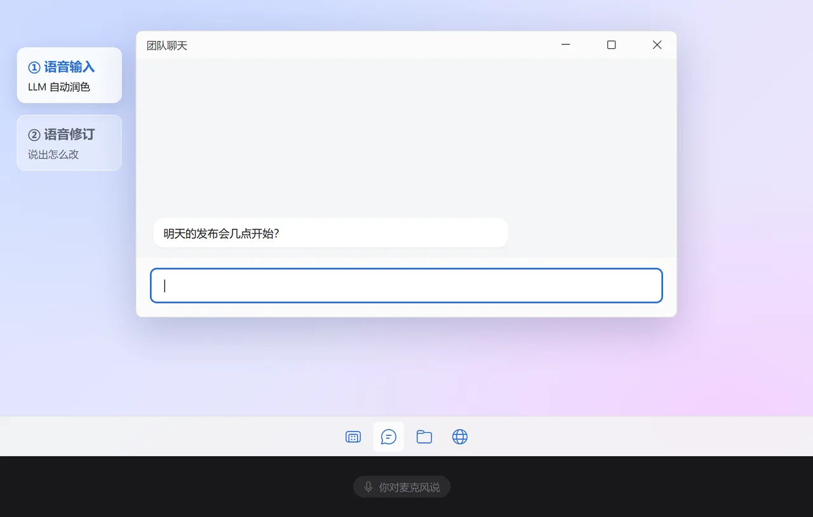
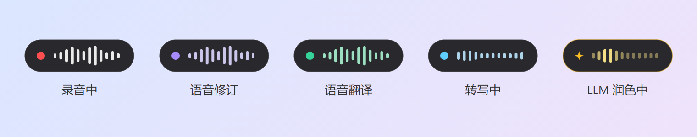
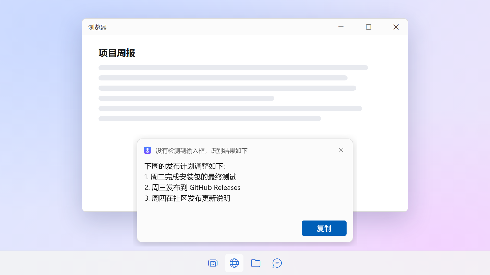
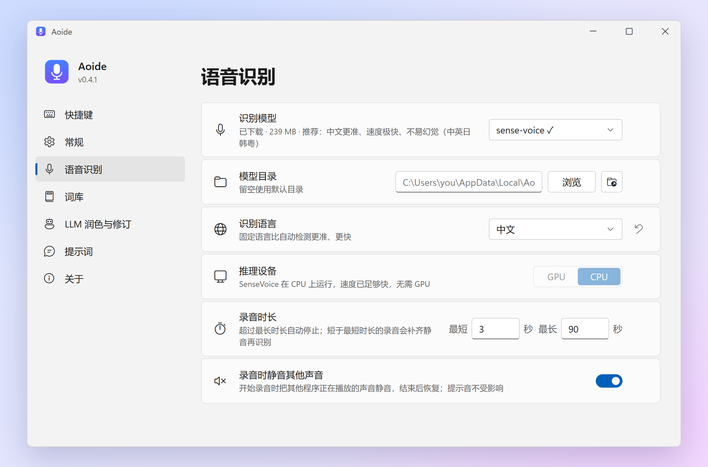

<p align="center">
  
</p>

<h1 align="center">Aoide</h1>

<p align="center">
  <b>Windows 和 macOS 上的本地语音输入工具</b><br>
  按快捷键说话，再按一次结束，文字直接输入到当前焦点所在的输入框。
</p>

<p align="center">
  <a href="https://parad1se98.github.io/aoide/"><b>parad1se98.github.io/aoide</b></a>
</p>

<p align="center">
  <a href="https://github.com/PaRaD1SE98/aoide/releases/latest"></a>
  <a href="https://github.com/PaRaD1SE98/aoide/releases/latest"></a>
  <a href="LICENSE"></a>
  
</p>

<p align="center">
  <a href="README.md">English</a> · <b>简体中文</b> · <a href="README.ja.md">日本語</a>
</p>

<p align="center">
  
</p>

<p align="center"><sub><i>Aoide</i>（阿俄伊得）得名于希腊神话中掌管歌声与嗓音的缪斯</sub></p>

Aoide 是一款 Windows 和 macOS 平台的语音输入应用，是 Typeless、Wispr Flow 等商业工具的开源替代实现。

语音在本机由 [SenseVoice](https://github.com/FunAudioLLM/SenseVoice)（通过 [sherpa-onnx](https://github.com/k2-fsa/sherpa-onnx) 运行）或 [whisper.cpp](https://github.com/ggml-org/whisper.cpp)（Windows 上通过 Vulkan、macOS 上通过 Metal 进行 GPU 加速）识别，可选通过任意 OpenAI 格式 API 交给 LLM 润色，然后直接输出到当前焦点所在的输入框。

不需要账号、不依赖云服务。只有当你选择用语音识别 API 代替本地模型时，音频才会离开你的电脑。

## 功能

| 功能 | 操作 | 效果 |
|---|---|---|
| **语音转写** | 单击 `右Alt` → 说话 → 再单击 `右Alt` | 转录 + 润色后填入当前输入框 |
| **取消** | 录音或识别过程中按 `Esc` | 放弃本次任务，不输出任何内容 |
| **语音修订** | 选中一段文本 → 按住 `右Alt` 再按 `Space` → 口述修改意见 → 单击 `右Alt` | LLM 按你的意见改写选中文本并替换 |
| **语音翻译** | 按住 `右Alt` 再按 `T` → 说话 → 单击 `右Alt` | LLM 把你说的话翻译成目标语言后输入。随后弹出的小窗里显示识别出的原文：有识别错误可以直接改，点 **重新翻译** 就会替换输入框里的译文。目标语言可以在录音时于悬浮条上方选择，也可以在设置里改 |

> macOS 上默认快捷键是 `右Option`，托盘图标在菜单栏里。日文（JIS）键盘上往往没有这两个键，默认改为 Windows 的 `変換` 键、macOS 的 `右Command`；语音修订是该键加 `Space`。

- **反馈**：开始、结束、取消各有不同的提示音；屏幕底部的悬浮条显示当前所处的阶段；托盘图标录音时带红色角标，完成时带绿色角标。出错等消息显示在屏幕底部的提示小窗里，几秒后自动关闭（不使用系统通知，关掉了通知也不会错过）。

  

- **智能输出**：焦点控件可输入时直接粘贴，粘完自动恢复你原来的剪贴板文本；否则在屏幕底部弹出一张结果卡片显示识别结果，带「复制」和「关闭」按钮，内容不会丢失。

  

- **按上下文插入**：光标在已有文字中间时，LLM 会参考光标前后的文字，只生成应该插入光标处的内容，并与前后文的语言、标点自然衔接。已有文字绝不会被改动（结果是在光标处粘贴的）。很短的口述直接插入转写结果、保证速度，较长的才交给 LLM（阈值可调）。需要配置 LLM API；密码框的内容绝不会被读取。
- **记住你的词**：人名、产品名、行业术语总被识别错，只需改正一次。识别结果输入后，直接在输入框里把错的词改对，Aoide 会比对你的修改和它输入的内容，确认两者读音相近（不会把你换了说法误当成识别错误），把这组纠正加入词库，并弹出带 **撤销** 按钮的提示。之后再遇到：反复纠正过的误识别直接替换，其余的连同相关词条交给 LLM 结合上下文改正。也可以在 **设置 → 词库** 里手动添加。
- **LLM 润色**：去掉语气词（嗯、啊、那个……），把断句连成完整句子，多个并列要点自动排成编号列表 —— 不会添加你没说的内容。
- **自动更新**：每天检查一次新版本，通过屏幕底部的提示小窗和托盘菜单提醒你，一键即可更新：自动下载带签名的安装包、校验后安装，装完自动重启。正在语音输入时不会更新。可以在 **设置 → 关于** 里手动检查，也可以关掉每日检查。
- **两种识别引擎**：SenseVoice（默认）在任何 CPU 上都很快，中文识别准确，几乎不会产生幻觉；Whisper 模型通过 Vulkan 在 GPU 上运行（支持 NVIDIA、AMD、Intel 显卡，无需安装 CUDA），没有可用 GPU 时自动退回 CPU。Apple 芯片的 Mac 上通过 Metal 在 GPU 上运行。

> 界面支持中文、英文和日文（设置 → *显示语言*，默认跟随系统语言）。转录支持中文、英文、日语、韩语、粤语等多种语言。

## 安装

### Windows

1. 从 [Releases](https://github.com/PaRaD1SE98/aoide/releases) 下载 `Aoide_x.y.z_x64-setup.exe` 并运行。安装到当前用户，不需要管理员权限。
2. 首次启动会打开设置窗口 —— 点击 **下载** 获取默认的 `sense-voice` 模型（239 MB）。Whisper 模型也可以在同一个列表中选择。
3. 在任意位置单击 `右Alt` 开始说话。

**环境要求：** Windows 10/11 x64。SenseVoice 只需要 CPU；Whisper 模型在支持 Vulkan 的显卡驱动下会快得多（较新的 NVIDIA、AMD、Intel 驱动均支持）。WebView2 运行时在 Windows 11 上已预装，Windows 10 缺失时安装程序会自动安装。

### macOS

1. 从 [Releases](https://github.com/PaRaD1SE98/aoide/releases) 下载 `Aoide_x.y.z_aarch64.dmg`（Apple 芯片）或 `Aoide_x.y.z_x64.dmg`（Intel 芯片），打开后把 Aoide 拖进「应用程序」。
2. Aoide 没有经过 Apple 公证，首次打开会被系统拦下。打开 **系统设置 → 隐私与安全性**，滚动到下方点击 **仍要打开**。
3. Aoide 会先请求使用麦克风。之后设置窗口顶部会列出还缺少的权限：点 *辅助功能*（用于监听快捷键和粘贴文字）旁的 **打开系统设置**，在那里打开 Aoide 的开关。列表会自动更新，快捷键随即生效，不用重启。
4. 在设置窗口下载模型，然后在任意位置单击 `右Option` 开始说话。

**环境要求：** macOS 11 或更新版本，Apple 芯片或 Intel 芯片均可。Whisper 模型只在 Apple 芯片上用 GPU（Metal）加速，Intel Mac 上只用 CPU，建议使用 SenseVoice。

Aoide 使用临时签名而不是 Apple 开发者证书签名，macOS 会把每次更新后的 Aoide 当成新程序，要求重新授予辅助功能权限。Aoide 会自动清掉辅助功能列表里失效的旧条目，在设置窗口点 **打开系统设置**，重新打开 Aoide 的开关即可。macOS 没有按程序调节音量的接口，「录音时静音其他程序」在 macOS 上会静音整个输出设备。

模型从 Hugging Face 下载，可通过环境变量 `HF_ENDPOINT` 使用镜像站。

## 使用

从开始菜单启动 Aoide 会打开主窗口。关闭窗口后程序继续在系统托盘运行，快捷键照常可用；单击托盘图标或再次启动即可重新打开窗口，右键托盘图标 → *退出* 结束程序。开机自启时只在托盘运行，不弹出窗口。

macOS 上 Aoide 在菜单栏中运行：单击图标打开窗口，右键图标打开菜单。只有窗口开着时程序坞里才显示图标。



### 用 API 识别语音（可选）

默认用本地模型识别。想改用云端或自建的服务时，在 **设置 → 语音识别 → 识别方式** 选择 **API**，再填写 API 地址、API Key 和模型名。

Aoide 使用 OpenAI 的语音识别格式（`POST {API 地址}/audio/transcriptions`），这是事实上的通用格式，很多服务都提供：

| 服务 | API 地址 | 模型名（示例） |
|---|---|---|
| OpenAI | `https://api.openai.com/v1` | `gpt-4o-mini-transcribe`、`whisper-1` |
| Groq | `https://api.groq.com/openai/v1` | `whisper-large-v3-turbo` |
| 硅基流动 | `https://api.siliconflow.cn/v1` | `FunAudioLLM/SenseVoiceSmall` |
| Mistral | `https://api.mistral.ai/v1` | `voxtral-mini-latest` |
| 自建（vLLM、LocalAI 等） | 如 `http://localhost:8000/v1` | 你部署的模型 |

使用其他格式的服务（Deepgram、Azure、Gemini、ElevenLabs 等）可以经 [LiteLLM](https://docs.litellm.ai/docs/audio_transcription) 转成这个格式再接入。识别语言和词库（作为提示词）会一起发送。下载过本地模型时，仍会先在本地切掉静音，没有说话的录音不会上传。

### 配置 LLM（润色 / 语音修订）

支持任意 OpenAI 格式 API，本地或远程均可。在设置中填写：

- *API 地址* —— 如 `https://api.openai.com/v1`
- *API Key* —— 服务端不需要时留空
- *模型名*

**「关闭思考」**（默认开启）通过 `reasoning_effort` 等标准 API 参数让推理模型跳过思考过程，可以明显降低延迟。不支持这些参数的服务会自动退回普通请求。

## 配置项

配置保存在 `%APPDATA%\Aoide\config.json`（macOS：`~/Library/Application Support/Aoide/config.json`），一般通过设置窗口修改。

| 键 | 默认值 | 说明 |
|---|---|---|
| `ui_language` | `auto` | 显示语言：`auto`（跟随系统）/ `zh` / `en` / `ja` |
| `hotkey` | `right alt` | 开始/停止录音（单击触发）。macOS 上默认为 `right option`；日文（JIS）键盘上 Windows 默认为 `convert`（変換），macOS 默认为 `right command` |
| `revise_hotkey` | `right alt+space` | 开始语音修订。`<主快捷键>+<某键>` 表示按住主快捷键再按该键 |
| `revise_stop_hotkey` | `right alt` | 停止语音修订（与 `hotkey` 相同时合并为单击逻辑） |
| `cancel_hotkey` | `esc` | 取消本次录音或识别；只在任务进行中拦截该键 |
| `translate_hotkey` | `right alt+t` | 开始语音翻译（按住主快捷键再按该键），单击主快捷键结束 |
| `translate_language` | `English` | 语音翻译的目标语言，可填任意语言名 |
| `speech_source` | `local` | 语音识别方式：`local`（本地模型）/ `api`（OpenAI 格式的语音识别 API） |
| `speech_api` / `speech_api_key` / `speech_api_model` | *（空）* | `speech_source` 为 `api` 时使用的 API 地址、Key 和模型名 |
| `model` | `sense-voice` | SenseVoice：`sense-voice`（中英日韩粤）/ `sense-voice-yue`（粤语增强）。Whisper：`tiny` / `base` / `small` / `medium` / `large-v3-turbo-q5_0` / `large-v3-turbo` / `large-v2` / `large-v3` |
| `model_dir` | *（空）* | 模型存放目录，留空 = `%LOCALAPPDATA%\Aoide\models`（macOS：`~/Library/Application Support/Aoide/models`） |
| `language` | `auto` | 转录语言，`auto` 为自动检测。SenseVoice 支持 `zh` / `en` / `ja` / `ko` / `yue` / `auto` |
| `max_duration` | `90` | 单次录音最长秒数，超时自动停止 |
| `min_duration` | `3` | 短于此秒数的录音用静音补齐到该长度再识别；设 `0` 关闭 |
| `mute_while_recording` | `true` | 录音期间静音其他正在播放声音的程序，结束后恢复；Aoide 自己的提示音不受影响。macOS 上静音的是输出设备 |
| `device` | `gpu` | `gpu`（Vulkan；Apple 芯片的 Mac 上为 Metal，Intel Mac 上为 CPU）/ `cpu`。仅对 Whisper 生效，SenseVoice 固定使用 CPU |
| `polish` | `true` | 是否启用 LLM 润色（`polish_api` 为空时自动跳过） |
| `polish_api` | *（空）* | OpenAI 格式 API base，如 `https://api.openai.com/v1` |
| `polish_api_key` | *（空）* | API Key，不需要时留空 |
| `polish_model` | *（空）* | 模型名 |
| `polish_no_think` | `true` | 通过 API 参数（`reasoning_effort` 等）让推理模型跳过思考；不支持时自动忽略 |
| `polish_min_seconds` | `10` | 录音短于此秒数时不润色，直接输出转写结果 |
| `polish_min_chars` | `12` | 转录结果短于此字符数（去空格）时不润色直接输出；语音修订不受影响 |
| `insert_smart` | `true` | 光标前后有文字时按上下文插入 |
| `insert_min_seconds` / `insert_min_chars` | `10` / `12` | 录音 / 转写结果短于此值时直接插入，不调用 LLM |
| `vocab_enabled` | `true` | 用词库纠正识别结果：反复出现的误识别直接替换，其余连同相关词条交给 LLM |
| `learn_from_edits` | `true` | 识别结果输入后你手动改正的词，自动加入词库（并弹出可撤销的提示） |
| `auto_check_updates` | `true` | 每天检查一次新版本并通知你；是否更新始终由你决定 |
| `polish_prompt` / `revise_prompt` / `insert_prompt` / `translate_prompt` | *（空）* | 自定义润色提示词（含 `{text}`）、修订提示词（含 `{original}`、`{instruction}`）、插入提示词（含 `{before}`、`{after}`、`{text}`）和翻译提示词（含 `{language}`、`{text}`），留空使用内置提示词，可在设置页编辑 |

词库保存在 `%APPDATA%\Aoide\vocabulary.json`。日志文件为 `%APPDATA%\Aoide\logs\app.log`（超过 1 MB 自动轮转）。macOS 上分别是 `~/Library/Application Support/Aoide/vocabulary.json` 和 `~/Library/Application Support/Aoide/logs/app.log`。日志包含你的转录内容，只保存在本机。

## 从源码构建

Aoide 是一个 [Tauri 2](https://tauri.app/) 应用：后端为 Rust（`src-tauri/`），设置窗口为纯 HTML/CSS/JS（`ui/`）。sherpa-onnx 从源码构建，并去掉了语音合成（TTS）模块，因此程序中不含任何 GPL 代码（espeak-ng）。

### Windows

前置工具（均可通过 `winget` 安装）。Visual Studio 2022 需要 **17.10 或更新版本** —— ONNX Runtime 预编译库依赖较新的 MSVC STL：

```powershell
winget install Rustlang.Rustup OpenJS.NodeJS.LTS pnpm.pnpm Kitware.CMake LLVM.LLVM KhronosGroup.VulkanSDK
winget install Microsoft.VisualStudio.2022.BuildTools --override "--add Microsoft.VisualStudio.Workload.VCTools --includeRecommended --passive"
cargo install cargo-about --locked --features cli   # 用于生成第三方许可页
```

然后在 PowerShell 中：

```powershell
. .\scripts\build-env.ps1            # 加载 MSVC 环境、Vulkan SDK 和 LLVM 路径
.\scripts\build-sherpa-onnx.ps1      # 只需一次：构建不含 TTS 的 sherpa-onnx → src-tauri\vendor\sherpa-onnx
.\scripts\third-party-licenses.ps1   # 随安装包附带的许可页 → src-tauri\vendor\THIRD_PARTY_LICENSES.html
pnpm install
pnpm tauri dev                       # 开发模式运行
pnpm tauri build                     # 构建安装包 → src-tauri\target\release\bundle\nsis\
```

构建 sherpa-onnx 和首次构建应用（编译 whisper.cpp 及其 Vulkan 着色器）都比较耗时。依赖变化后请重新运行 `third-party-licenses.ps1`。

### macOS

前置工具：Xcode 命令行工具、[Rust](https://rustup.rs/)，以及通过 [Homebrew](https://brew.sh/) 安装的：

```bash
xcode-select --install
brew install node pnpm cmake
brew install --cask powershell                     # 运行许可页生成脚本
cargo install cargo-about --locked --features cli
```

然后：

```bash
./scripts/build-sherpa-onnx.sh           # 只需一次：构建不含 TTS 的 sherpa-onnx → src-tauri/vendor/sherpa-onnx
pwsh ./scripts/third-party-licenses.ps1  # 随应用附带的许可页
pnpm install
pnpm tauri dev                           # 开发模式运行
pnpm tauri build                         # 构建应用 → src-tauri/target/release/bundle/dmg/
```

开发模式下，macOS 会为启动 Aoide 的终端程序申请辅助功能权限。

### 平台相关代码

与操作系统打交道的代码（键盘钩子、模拟按键、焦点检测、静音、悬浮条窗口、提示音）在 `src-tauri/src/win/` 和 `src-tauri/src/macos/` 中，两者提供相同的接口；其余代码两个平台共用。

README 中的截图由 `.\scripts\readme-images.ps1` 在内存中渲染生成（程序自身的绘制代码 + 无头浏览器渲染真实界面页面），演示动图由 `.\scripts\readme-demo.ps1` 生成（另需 [FFmpeg](https://ffmpeg.org/)），界面改动后重新运行即可更新。

## 致谢

- 音效：**Kenney**（[www.kenney.nl](https://www.kenney.nl)）的 [Interface Sounds](https://kenney.nl/assets/interface-sounds)，CC0
- 语音识别：[SenseVoice](https://github.com/FunAudioLLM/SenseVoice)（通过 [sherpa-onnx](https://github.com/k2-fsa/sherpa-onnx) 运行）、[whisper.cpp](https://github.com/ggml-org/whisper.cpp)（通过 [whisper-rs](https://codeberg.org/tazz4843/whisper-rs) 调用）
- Windows 安装包附带 [Khronos Vulkan Loader](https://github.com/KhronosGroup/Vulkan-Loader)（Apache-2.0），使程序在没有 Vulkan 驱动的机器上也能启动

## 许可证

[MIT](LICENSE)。Aoide 还包含若干第三方开源组件，它们各自采用自己的许可证（MIT、Apache-2.0、BSD 等）；完整列表和许可证原文随应用附带，见 **设置 → 关于 → 第三方许可**。
